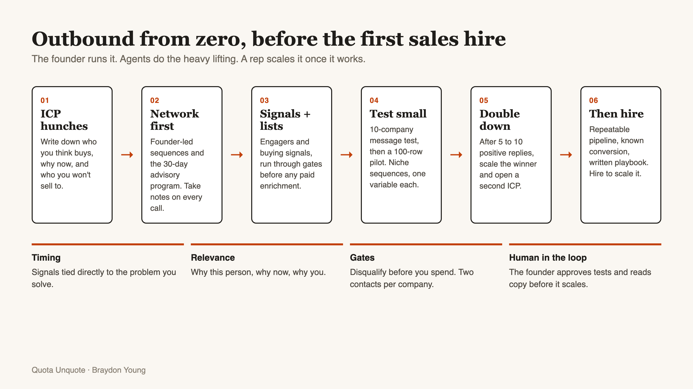
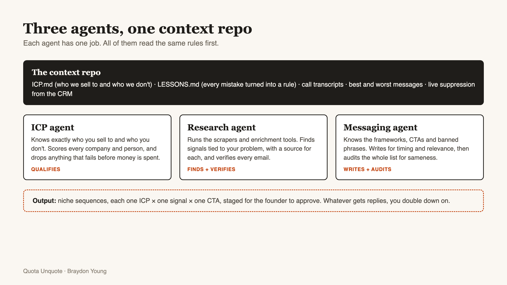

# The Founder Outbound Kit

From [Quota Unquote](https://braydonyoung.substack.com) by Braydon Young. Companion to the post "Don't Hire a Sales Rep Until You Can Hand Them a Playbook."

This kit is the system I'd give a seed-stage founder who wants outbound working before they make a first sales hire. It assumes you'll run it with Claude Code, but the templates work with any AI tool that can read files.

## What's inside

| File | What it's for |
|---|---|
| `OUTBOUND-GUIDE.md` | The step-by-step, week-by-week guide to building outbound from zero |
| `templates/CLAUDE.md` | The instructions file for your context repo. It tells the AI what to read and which rules never bend |
| `templates/ICP.md` | A fill-in-the-blanks ICP file: segments, exclusions, title-by-pain matrix, signals, suppression |
| `templates/LESSONS.md` | Where every mistake becomes a rule the agent reads next time |
| `skills/icp-builder/` | Turns call notes and customer data into a tested ICP and keeps it updated |
| `skills/signal-list-builder/` | Builds lists from post engagers and buying signals, then researches each person |
| `skills/gated-list-builder/` | Runs a list through fixed gates so you never pay to enrich a company you'd reject |
| `skills/outbound-writer/` | Writes timing-and-relevance messages, runs the 10-company test and the sameness audit |

## Setup in 15 minutes

1. Make a new folder for your GTM work and open it in Claude Code.
2. Copy everything in `templates/` into the root of that folder.
3. Copy the `skills/` folder into `.claude/skills/` inside it.
4. Fill in `ICP.md` with your hunches. They don't need to be right yet. They need to be written down.
5. Drop in anything you already have: call transcripts, your best emails, customer list, pricing page copy.
6. Ask Claude: "Read CLAUDE.md and ICP.md, then use the icp-builder skill to tighten my ICP from the transcripts in /calls."

## The workflow





```
ICP (hunches) → network sequence → first replies → tighten ICP
      ↓
Signals + engagers → gated list → verified emails → 10-company message test
      ↓
Niche sequences (one ICP × one signal × one CTA each) → measure replies
      ↓
5-10 positive replies → double down + open a second ICP → write the playbook
      ↓
Repeatable pipeline + known conversion → hire someone to scale it
```

## Ground rules that apply to everything

- The founder reviews the 10-company test and every new message pattern before it scales.
- Nothing gets sent to a company or person who fails the ICP or suppression check.
- Disqualify before you spend. Enrichment is the last step, never the first.
- No more than two contacts per company.
- Every mistake becomes a line in `LESSONS.md`.

## License

Free to use and adapt under [CC BY 4.0](LICENSE). If you share it, link back to Quota Unquote.

Questions? Message me on [LinkedIn](https://www.linkedin.com/in/braydonyoung/).
